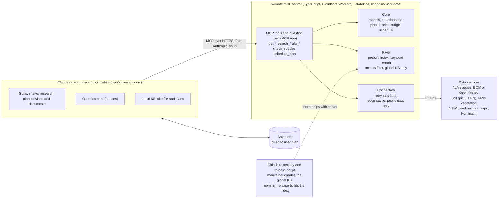
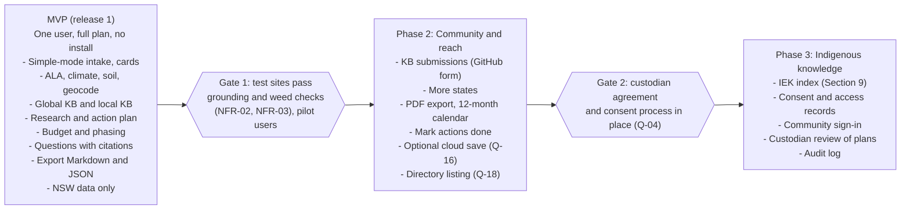

# Greener — Requirements and Technical Specification

Version 0.1 · 24 Nov 2026 · Exported from Claude Docs. Save as `docs/specification.md`. This file is the source of truth for all coding tasks (Section 12.1).

## 1. Purpose and scope

Greener is a Claude plugin with a remote MCP server. It uses Claude in the user's own account to help land holders in Australia increase the biodiversity of their own site.

The system does four tasks:

1. It asks the user standard questions to collect site data.
2. It gets data about local plants, animals, climate and soil from Australian data services.
3. It writes a site-specific action plan.
4. It answers user questions about the site, the species and the plan.

This document is draft v0.1. We will develop it in iterations. Each iteration closes open questions from Section 10 and updates the decision log in Section 2.

Out of scope for release 1 (MVP): Indigenous ecological knowledge, user accounts, payments, KB submissions to the global list, and countries other than Australia. Section 10 shows the later phases.

## 2. Decision log

Twenty-three decisions are closed. Each new decision gets a new row.

| ID | Decision | Result | Effect on design |
| --- | --- | --- | --- |
| D-01 | Delivery model | Claude plugin first (see D-05). | The core logic sits behind MCP tools. The plugin skills are a thin layer on top. |
| D-02 | Geographic scope | Australia only. NSW first for MVP. | Use the Atlas of Living Australia (ALA), state data and council lists. No global fallback in release 1. MVP uses NSW state data and NSW council lists only; other states come in Phase 2. |
| D-03 | LLM provider | Anthropic only | Claude in the user's own account does all reasoning. No provider adapter layer. |
| D-04 | RAG sources | MVP: global curated KB and each user's own local KB. Later: KB submissions (Phase 2), IEK (Phase 3). | See D-11, D-13 and D-15. |
| D-05 | Who pays, and how users install | Plugin with skills plus a **stateless remote MCP server**. Users install from Claude with no local setup. | Works on claude.ai web, desktop and mobile. Developer pays hosting only. |
| D-06 | RAG search | Index built at release time. MVP uses keyword (BM25) search on the server. | Embeddings are a later option if keyword recall is too low. |
| D-07 | Answer mode | Simple mode by default: 4–6 icon buttons, *Other* and *Not sure* | A question card (MCP App) shows buttons on web and desktop. Claude Code gets a numbered list. |
| D-08 | Server language | TypeScript | Best support for Cloudflare Workers and the MCP Apps SDK. |
| D-09 | User data on the server | None | Claude sends the needed site facts in each tool call. Plans and the user KB stay in the user's Claude account. |
| D-10 | Hosting | Cloudflare Workers free plan | Assumed to fit the free plan (Q-17). If use grows past it, donations fund the paid plan (D-16). |
| D-11 | Knowledge base model | Global KB curated by the maintainer. Each user adds their own items to a local KB in their Claude Project. | The global index ships with the server. The user KB never goes to the server. |
| D-12 | Project model | Open source on GitHub, with standard repository files and local build and deploy scripts. Manual merges; no GitHub Actions. | Section 11. Licences in D-14. |
| D-13 | IEK | Moved out of MVP to Phase 3 | Section 9 stays as the design for Phase 3. No IEK code or content in MVP. |
| D-14 | Licences | Apache-2.0 for code. CC BY 4.0 for KB text that the maintainer writes. | `LICENSE` at the root; `kb/LICENSE` for KB text. |
| D-15 | Global KB content | Two tiers: **open content** (full text, only with an open licence or permission) and a **link catalogue** (URL, metadata and a thorough summary in our own words). No private KB. | The repository stays fully public. Claude reads link-catalogue sources live when web access is on (Section 7.4). |
| D-16 | Funding | Voluntary donations through Buy Me a Coffee, linked from the GitHub page | `.github/FUNDING.yml` shows a Sponsor button. The README links it. The tool stays free; no feature needs a donation. |
| D-17 | Planting and chemical policy | Rewilding with Australian native plants only (local natives preferred), never invasives, and no chemicals. No herbicides, pesticides, poison baits, fungicides or chemical fertilisers in any action. | `check_species` and `save_plan` block priority weeds, state-flagged pests, species recorded as introduced near the site, and species not native to Australia. A non-local Australian native is allowed with a warning (FR-22). `save_plan` refuses actions that use chemicals. Weeds and pests are managed by hand removal, smothering, exclusion and revegetation. |
| D-18 | Bushfire-prone land source | NSW RFS Bush Fire Prone Land map (CC BY), queried on `portal.spatial.nsw.gov.au` | `bushfire_status` checks about 100 m around the site (3 decimal places), not cached. The council's certified map stays authoritative (FR-03). |
| D-19 | Geocoding source | NSW Address Location Service (CC BY) for street addresses | `geocode` sends a structured street address, not cached and not logged. Suburb-only lookup waits for a confirmed licence (FR-02). |
| D-20 | Vegetation community source | NSW State Vegetation Type Map, pre-clearing (CC BY) | `vegetation_community` returns the likely original Plant Community Type at 3 decimal places, not cached (FR-14). |
| D-21 | Climate source (closes Q-06) | Open-Meteo Historical Weather API, ERA5 1991–2020 (CC BY 4.0, free non-commercial tier; donations permitted) | `climate_normals` computes monthly temperature and rainfall and cold-night counts at 1 decimal place, cached 30 days (FR-12). |
| D-22 | Soil source | Soil and Landscape Grid of Australia map services on `soils.csiro.au` (CC BY 4.0) | `soil_properties` returns modelled pH, clay, sand and organic carbon at 0–5 and 5–15 cm, 3 decimal places, not cached (FR-13). |
| D-23 | Species photos | Wikimedia Commons photos picked by Wikidata (P18), stored as links in `data/species-images.csv` and reviewed by hand; other species looked up live. Only CC0, public domain, CC BY and CC BY-SA. | `get_species_images` returns a thumbnail link, file page, creator, licence and credit line, never image bytes. Unreviewed photos are labelled as examples (FR-17). |

D-05 and D-06 changed on 24 Nov 2026 so that non-technical users need no install and no local setup. D-17 was added on 24 Nov 2026 by the maintainer. D-18 to D-22 were added on 25 Nov 2026, when each data source was checked; the ADRs in `docs/adr/` record what was checked. D-23 was added on 26 Nov 2026 at the maintainer's request.

## 3. Users and use cases

Release 1 serves technical users who run a CLI on their own computer. Phase 2 adds non-technical users through a web app.

| Persona | Site type | Main need | Release |
| --- | --- | --- | --- |
| Suburban home owner | Backyard, 200–1,000 m² | Attract birds and pollinators. Remove weeds. | 1 |
| Rural land holder | Acreage or farm, 1–500 ha | Revegetate, protect remnant bush and creeks, control pest animals. | 1 |
| Renter or apartment resident | Balcony or courtyard | Low-cost, removable habitat. | 1 |
| Community group or school | Shared site | A plan that a group can follow and monitor. | 2 |
| Cultural centre | Country with Traditional Owner custodians | Combine IEK with ecological data, with cultural approval. | 2 |

Core use cases:

1. **UC-1 Site intake.** The user answers the questionnaire. The system saves a site profile.
2. **UC-2 Research.** The system gets local species, climate and soil data. An agent writes a research report.
3. **UC-3 Plan.** An agent writes an action plan from the profile, the report and the knowledge base.
4. **UC-4 Ask.** The user asks free-text questions. The system answers with citations.
5. **UC-5 Update.** The user changes an answer or adds documents. The system updates the plan.
6. **UC-6 Export.** The user exports the plan as Markdown or PDF.

## 4. Functional requirements

Priority uses MoSCoW: M = must, S = should, C = could. Release 1 contains all M items.

### 4.1 Site intake

| ID | Requirement | Priority |
| --- | --- | --- |
| FR-01 | The system must ask a standard question bank. Topics: location, area, site type, land cover, existing vegetation, water, soil, sun and shade, pets, chemical use, goals, budget, time per week, constraints, observed wildlife, weeds and pests. | M |
| FR-02 | The system must convert an address, suburb or postcode into coordinates. The system must also accept latitude and longitude, and the user's current location. | M |
| FR-03 | The system must record the bushfire-prone land status of the site. The user can enter it or the system can look it up. | M |
| FR-04 | An agent should ask up to 3 follow-up questions when answers are missing or conflict. | S |
| FR-05 | The system must accept answers from a JSON or YAML file for non-interactive use. | M |
| FR-06 | The user must be able to change one answer without a full repeat of the questionnaire. | M |
| FR-07 | Simple mode is the default. Each question shows 4–6 options as icon buttons with a short label. Numeric questions use ranges, not exact values. | M |
| FR-08 | Each question must have an *Other* option for a free-text answer. Questions where the user may not know must have a *Not sure* option. The system then fills the gap from data, or records a data gap. | M |
| FR-09 | Where the host cannot show buttons (for example Claude Code), the same options must show as a numbered text list. The user answers with a number. | M |
| FR-10a | A *Detailed* mode must be available. It asks exact values (for example percent land cover, hours for each season). | S |
| FR-10b | Skip logic must hide questions that do not apply. Example: an apartment does not get creek, livestock or acreage questions. | M |

### 4.2 Research

| ID | Requirement | Priority |
| --- | --- | --- |
| FR-10 | The system must get species occurrence records from ALA in a set radius around the site. Default radius: 10 km. | M |
| FR-11 | The system must tag each species as native, introduced, threatened or declared weed or pest, where data exists. | M |
| FR-12 | The system must get climate normals (temperature, rainfall, frost) for the site. | M |
| FR-13 | The system must get soil properties (pH, texture, organic carbon) for the site. | M |
| FR-14 | The system should identify the pre-clearing vegetation community for the site from state vegetation maps. | S |
| FR-15 | The research agent must write a report. It must list key native plants, key fauna, threatened species, invasive species and data gaps. | M |
| FR-16 | The system must cache API responses. Default time to live: 7 days. | M |
| FR-17 | The system should show a photo of key species in research and plan output, with the creator, licence and a link to the source page. Only licences that allow reuse with attribution, and no image bytes on the server (D-23). | S |

### 4.3 Action plan

| ID | Requirement | Priority |
| --- | --- | --- |
| FR-20 | The planning agent must write a structured plan. The plan contains goals, quick wins, actions, a planting list, a monitoring plan and local resources. | M |
| FR-21 | Each action must have a category, priority, effort, cost band, season, steps, target species, rationale and cautions. | M |
| FR-22 | The planting list must contain only species that are native to the local area, or the system must give a clear warning. | M |
| FR-23 | The plan must obey site constraints. Examples: bushfire asset protection zones, renter limits, council rules, budget. | M |
| FR-24 | The plan must not recommend a declared weed or a pest animal for planting or release. | M |
| FR-25 | Each recommendation must cite at least one source from the knowledge base or the research data. | M |
| FR-26 | The system should give a seasonal calendar of tasks for 12 months. | S |
| FR-27 | The system could compare plan versions and show changes. | C |

### 4.4 Query

| ID | Requirement | Priority |
| --- | --- | --- |
| FR-30 | The user must be able to ask free-text questions about the site, species and plan. | M |
| FR-31 | Answers must include citations to retrieved sources. | M |
| FR-32 | When the system has no data, it must say so. It must not guess. | M |
| FR-33 | The query agent should call live APIs for species that are not in the site data. | S |
| FR-34 | The system must keep the chat history for each site. | M |

### 4.5 Knowledge base

| ID | Requirement | Priority |
| --- | --- | --- |
| FR-40 | The maintainer must curate one global KB. It holds best-practice guides and references to government and council information. | M |
| FR-41 | Each global KB item must have metadata: title, source URL, publisher, licence, tier, region, date checked, and topic tags. | M |
| FR-42 | The global KB must have two tiers. *Open content*: full text, only when the licence permits redistribution (for example CC BY 4.0) or the maintainer wrote it. *Link catalogue*: URL, metadata, and a thorough summary that the maintainer writes in their own words: key facts, species, steps and figures, with no copied passages. | M |
| FR-43 | Each user must be able to add their own items to a local KB: files or notes in their Claude Project. The local KB must not go to the server. | M |
| FR-44 | Answers and plans must search both the global KB and the user's local KB. Each citation must show which KB it came from and link to the original source. | M |
| FR-45 | The release script must rebuild the global index from the KB source folder on each release. | M |
| FR-46 | When a link-catalogue item matches a question, the tool must return its URL and summary. Claude must then read the live source page for detail, and cite it. If web access is off, the plugin must ask the user to turn it on. Without it, answers use the KB summary and the link only, and say so. | M |
| FR-47 | A link check must find broken or moved URLs before each release. | M |
| FR-48 | Users should be able to propose a global KB item through a GitHub issue form. The maintainer reviews the licence and quality before it goes in. | Phase 2 |
| FR-49 | IEK must follow the rules in Section 9. | Phase 3 |

### 4.6 Output

| ID | Requirement | Priority |
| --- | --- | --- |
| FR-50 | The system must export the plan as Markdown and JSON. | M |
| FR-51 | The system should export the plan as PDF. | S |
| FR-52 | The system could produce a site map with planting zones. | C |

### 4.7 Budget and phasing

The plan must fit the user's real time and money. The system puts each action into a phase only when the user's capacity can hold it. It moves the remaining actions to a later phase and gives the reason. All money is in AUD.

| ID | Requirement | Priority |
| --- | --- | --- |
| FR-60 | The intake must collect: hours per week for each season, upfront budget, yearly budget, and paid help (none, sometimes, contractor). | M |
| FR-61 | Each action must have a labour estimate (low–high hours), a materials cost estimate (low–high AUD), a planting or work window, and dependencies on other actions. | M |
| FR-62 | Each action must have an ongoing maintenance load (hours per month) after it is complete. | M |
| FR-63 | The system must put actions into phases (Section 7.7). No phase can use more hours or money than the user has. | M |
| FR-64 | Maintenance from completed actions must reduce the capacity for new work in later months. | M |
| FR-65 | The plan must show a budget table: cost for each phase, cost for each year, and running total, as low–high ranges. | M |
| FR-66 | The plan must list deferred actions with the reason (time, money, season or dependency). | M |
| FR-67 | The plan should show what more time or money would add. Example: "With 2 more hours per week, actions 7 and 9 move to Phase 1." | S |
| FR-68 | Cost estimates must come from a dated cost reference table. Each estimate must show its date and say that it is an estimate. | M |
| FR-69 | The user must be able to enter local prices. These replace the reference values for that site. | S |
| FR-70 | When the system has no cost data for an item, it must say so. It must not invent a price. | M |
| FR-71 | The user should be able to mark actions as done. The system then updates the remaining phases. | S |

## 5. Non-functional requirements

Each target is a draft value. Confirm or change the values in the next iteration.

| ID | Area | Requirement | Target |
| --- | --- | --- | --- |
| NFR-01 | Accuracy | Species names in the plan must match the ALA taxonomy. | 100% of planting list entries resolve to an ALA name |
| NFR-02 | Grounding | Each factual claim in a plan or answer must have a citation. | ≥ 95% of claims in the evaluation set |
| NFR-03 | Safety | The plan must not recommend a declared weed for the site's state. | 0 failures in the evaluation set |
| NFR-04 | Performance | Full research and plan run for one site. | ≤ 5 minutes |
| NFR-05 | Performance | Answer to one question. | ≤ 20 seconds, 90th percentile |
| NFR-06 | Cost | Developer cost per user. Users must be able to do a full site run inside a standard Claude Pro usage window. | A$0 (to test) |
| NFR-07 | Resilience | When one data service fails, the run must continue and record a data gap. | No run stops for one API failure |
| NFR-08 | API etiquette | Obey the rate limits and terms of each service. Send a contact User-Agent. | Per service terms |
| NFR-09 | Privacy | The server keeps no site location, profile, plan or user document after a tool call ends (D-09). | No telemetry in release 1 |
| NFR-10 | Privacy | Threatened species locations must not appear in exports at a precision finer than the data source gives. | Follow ALA sensitive data rules |
| NFR-11 | Cultural safety | Phase 3: IEK content must follow Section 9. | Audit log for each IEK retrieval |
| NFR-12 | Portability | Work on claude.ai web, the desktop app and mobile with no local install. Claude Code works in text mode. | No user install |
| NFR-13 | Maintainability | Unit test coverage of the core library. | ≥ 80% line coverage |
| NFR-14 | Testability | All external APIs and the LLM must be replaceable with fakes. | Tests run offline |
| NFR-15 | Extensibility | The core must not depend on the CLI. A web API can use it without change. | Phase 2 ready |
| NFR-16 | Observability | Log each agent step, tool call, token use and cost. | Structured JSON logs |
| NFR-17 | Licensing | Record the licence of each source. Show attribution in exports. | CC BY attribution for ALA data |
| NFR-18 | Readability | User-facing text uses plain English. | Target reading age 12–14 (draft) |

## 6. Technical architecture

The system is a Claude plugin with a stateless remote MCP server (D-05). The user installs it from inside Claude and needs nothing on their computer. The user's Claude account does the reasoning. The server gets data, searches the knowledge base and enforces the plan rules. It keeps no user data (D-09).

### 6.1 Delivery options (D-05, revised: option B, stateless)

| Option | How it works | User pays with | Developer hosting cost | Works in |
| --- | --- | --- | --- | --- |
| A. Claude plugin, local MCP server | Skills hold the questionnaire and plan workflow. A local MCP server holds the data connectors and the RAG index. Claude in the user's account does the reasoning. | Claude subscription (Pro, Max, Team) | None | Claude desktop app, Claude Code |
| B. Claude plugin, remote MCP server | Same skills. The MCP server runs on a host that the developer controls. | Claude subscription | Small: one server and the shared index | claude.ai web, desktop, mobile, Claude Code |
| C. Python CLI, bring your own key | The design in Section 7. The user puts their own API key in `.env`. | Anthropic API credit (separate from a subscription) | None | Terminal only |

**Why option B now.** It is the only option with no install on any surface. A user adds it from Customize in Claude and it works on web, desktop and mobile. A local server needs the desktop app, and even a one-click desktop extension (.mcpb) needs a file download. Anthropic also recommends remote servers for directory listing. The .mcpb path stays as a possible offline fallback for desktop users.

**Hosting cost.** The server runs on the Cloudflare Workers free plan (D-10). It allows 100,000 requests a day with a 10 ms CPU limit for each request. The paid plan starts at USD 5 a month. Each tool must stay inside the CPU limit; external API waits do not count as CPU time, but local search and scheduling do. We must measure this (Q-17).

Effect on the design:

- **A and B** move agent control from Python code into skills. Claude follows the skill steps. The MCP tools enforce the rules: a `save_plan` tool validates the plan against its schema and runs the native and weed checks before it saves.
- **A and B** cannot control the model, step limit or token cost. The user's plan limits apply.
- **C** keeps full control and repeatable runs, but each user needs an API account.
- The core library (connectors, RAG, models, checks) is the same in all three. Only the top layer changes.
- For IEK, option A keeps the index on the user's computer. Option B puts it on the developer's server, so IEK-07 consent must cover that host.

### 6.2 Architecture (remote, stateless)



*Figure: Users install nothing. Claude reasons; a stateless server does the exact work.*

The user installs nothing. Site files and plans stay in the user's own Claude account. The server holds only public data and the prebuilt index.

## 7. Component specification

Skills tell Claude what to do in each step. MCP tools do the work that must be exact: data calls, search, validation and storage. A rule that must never fail goes in a tool, not in a skill.

### 7.1 Package layout

| Part | Responsibility |
| --- | --- |
| `plugin/.claude-plugin/plugin.json` | Plugin manifest. Names the remote connector URL; skills are found in `skills/`. |
| `plugin/skills/*` | One skill for each workflow step (Section 7.2). |
| `server/src/index.ts` | Remote MCP server (Streamable HTTP, stateless). Exposes the tools in Section 7.2. No business logic. |
| `server/src/core/models.ts` | Schemas (Zod): SiteProfile, ResearchReport, ActionPlan, Action, SpeciesRecord, Citation. |
| `server/src/core/questionnaire.ts` | Question bank, options, icons, skip logic. |
| `server/src/core/checks.ts` | Native, weed and constraint checks (FR-22 to FR-24). |
| `server/src/core/schedule.ts` | Budget and phasing engine (Section 7.7). |
| `server/src/connectors/*` | One client per data service. Retry, rate limit, edge cache. |
| `server/src/rag/*` | Search over the prebuilt index, with the access filter. |
| `server/ui/intake-card` | MCP App for the question card. |
| `tools/build-index` | Offline script. Ingests the global KB source folder and writes the index that ships with the server. |

### 7.2 Agents

| Skill | What Claude does | MCP tools it uses | Result saved |
| --- | --- | --- | --- |
| `site-intake` | Asks the question bank. Asks up to 3 follow-ups. | `get_question_bank`, `geocode`, `save_profile` | profile.json |
| `site-research` | Gets data and writes the research report. | `ala_species_near`, `ala_species_profile`, `climate_normals`, `soil_properties`, `vegetation_community`, `weed_status`, `search_knowledge`, `save_research` | research.json |
| `action-plan` | Writes the plan from the profile, report and guides. | `get_site`, `search_knowledge`, `check_species`, get\_cost\_reference, schedule\_plan, `save_plan` | plans/v\<n>.json and .md |
| `site-advisor` | Answers questions with citations. | `search_site`, `search_knowledge`, `get_plan_section`, `ala_species_profile` | none |
| `add-documents` | Adds the user's own items to their local KB (Claude Project files). | `none: Claude reads Project files directly` | user local KB |

Rules for all agents:

- Each `save_*` tool validates its input against the Pydantic model. On failure, it returns the errors so Claude can correct the input and try again.
- `save_plan` runs `checks.py` before it saves. It refuses a plan that lists a declared weed, and it flags any non-local species (FR-22, FR-24).
- Each tool returns citation IDs with its data. The skills tell Claude to keep them in the plan and answers (FR-25, FR-31).
- Tool results are short. Large data (for example 5,000 records) stays in the server, and the tool returns a summary.

### 7.3 Question bank (simple mode)

Each question below has an *Other* button in addition to the options shown. Money values are AUD. Icon names refer to a single open icon set (to be chosen, Q-14).

| # | Question | Simple-mode options (icon) | Select | Shown when |
| --- | --- | --- | --- | --- |
| 1 | Where is your site? | Use my location (pin) · Type suburb or postcode (search) | One | Always |
| 2 | What type of site is it? | Apartment or balcony (building) · Townhouse or courtyard (townhouse) · Suburban house (house) · Large block (trees) · Rural or farm (tractor) · School or community (people) | One | Always |
| 3 | How big is the area you can change? | Under 20 m² · 20–200 m² · 200–1,000 m² · 0.1–2 ha · 2–50 ha · Over 50 ha | One | Always |
| 4 | Do you own or rent? | Own (key) · Rent (door) · Strata or shared (building) · Public land (flag) | One | Always |
| 5 | What covers most of the area now? | Lawn (grass) · Garden beds (flower) · Paving or pots (tiles) · Pasture (field) · Native bush (eucalypt) · Mixed (grid) | One | Always |
| 6 | Are there trees? | None · 1–2 small · A few large · Many, or bushland | One | Not apartment |
| 7 | What water is there? | None · Bird bath · Pond · Creek or dam · Tank or irrigation | Many | Always |
| 8 | How much sun does the area get? | Full sun · Mostly sun · Half shade · Mostly shade | One | Always |
| 9 | What is the soil like? | Sandy · Loam · Clay · Rocky or shallow · Not sure | One | Not apartment |
| 10 | Which animals live with you? | None · Dog · Cat, indoor · Cat, outdoor · Livestock | Many | Livestock only for rural |
| 11 | Do you use sprays (pesticide or herbicide)? | Never · Sometimes · Often · Not sure | One | Always |
| 12 | Is the site on bushfire-prone land? | Yes · No · Not sure (we look it up) | One | Not apartment |
| 13 | What do you most want to attract or grow? | Birds · Bees and butterflies · Frogs and lizards · Native plants · Bush food · Threatened species | Up to 3 | Always |
| 14 | What wildlife do you see now? | Birds · Possums or bats · Frogs · Lizards · Insects · Not sure | Many | Always |
| 15 | Any problem weeds or pests? | None known · Weeds · Rabbits or foxes · Pest birds · Not sure | Many | Always |
| 16 | How many hours a week can you give? | Under 1 · 1–2 · 2–5 · 5–10 · Over 10 | One | Always |
| 17 | What can you spend to start? | Under 100 · 100–500 · 500–2,000 · 2,000–10,000 · Over 10,000 | One | Always |
| 18 | What can you spend each year after? | Under 100 · 100–500 · 500–2,000 · 2,000–10,000 · Over 10,000 | One | Always |
| 19 | Can you get help? | No, just me · Family or friends · Paid help sometimes · Contractor | One | Always |
| 20 | What is your experience? | Beginner · Some gardening · Experienced · Bush regeneration trained | One | Always |

Rules for simple mode:

- The system uses the middle of a range for calculations. It uses the high end for capacity checks in Section 7.7.
- Question 16 gives one weekly value. The system applies a default seasonal profile (less in summer heat). Detailed mode asks hours for each season.
- *Not sure* is a valid answer. The system fills it from data (soil, bushfire status) or records a data gap.
- An apartment user sees about 14 questions. A rural user sees all 20.

**Question card (MCP App)**

The MCP server shows each question as an interactive card in the conversation. The card uses the MCP Apps extension. Claude on the web and in the desktop app supports MCP Apps from a remote server, so the card works for most users. Claude Code shows the tool result as text only, so FR-09 applies there.

| Item | Specification |
| --- | --- |
| Tool | `ask_question(question_id)` returns the options as data and links a `ui://intake-card/<hash>` resource. The hash of the card HTML is in the URI, so hosts that cache by URI get a changed card. |
| Card layout | Question text, 4–6 icon buttons in a 3 × 2 grid, *Other* button, *Back* and *Skip* links, a progress bar (for example 5 of 14). |
| Answer | A button press sends the answer to the server, which saves it with `save_answer` and returns the next question. |
| Other | Opens a one-line text box. Claude reads the text and maps it to the profile, or asks one follow-up. |
| Multi-select | Buttons toggle. A *Done* button confirms. |
| Fallback | When the host does not support MCP Apps, the tool returns a numbered list. MCP Apps degrade to text by design. |
| Accessibility | Each button has a text label, not only an icon. Keyboard and screen reader use must work. Minimum target size 44 × 44 px. |
| Speed target | A simple-mode intake takes 5 minutes or less. 80% or more of answers use a button, not *Other*. We measure both in the pilot. |

```text
+--------------------------------------------------------------+
| Question 2 of 14                [=====-------------------]   |
|                                                              |
| What type of site is it?                                     |
|                                                              |
|  +----------------+  +----------------+  +----------------+  |
|  |   [building]   |  |  [townhouse]   |  |    [house]     |  |
|  |  Apartment or  |  |  Townhouse or  |  |   Suburban     |  |
|  |    balcony     |  |   courtyard    |  |   house  (*)   |  |
|  +----------------+  +----------------+  +----------------+  |
|  +----------------+  +----------------+  +----------------+  |
|  | [house + tree] |  |   [tractor]    |  |    [people]    |  |
|  |  Large block   |  | Rural or farm  |  |  School or     |  |
|  |                |  |                |  |  community     |  |
|  +----------------+  +----------------+  +----------------+  |
|                                                              |
|  [ Other (type an answer) ]                    Back   Skip   |
+--------------------------------------------------------------+
(*) = selected option, shown highlighted
```

*Figure: Question card mock-up. Simple mode answers each question with one tap.*

The user taps one button. The selected option shows highlighted, and the next question loads. Icons here are placeholders until we choose the icon set (Q-14).

### 7.4 RAG pipeline

The global KB has two tiers (D-15). Open-content items are indexed in full. Link-catalogue items are indexed by their summary and tags only. When a link-catalogue item matches, the tool returns its URL. Claude then reads the live page with its web fetch tool, so the server never stores or sends a copy of that source. At the start, the intake skill checks for web access. If it is off, Claude asks the user to turn it on. If the user does not, Claude uses the thorough KB summary and the link, and says that it could not read the live source. Summaries are written to be useful on their own for this case.

1. Load the document. Extract text and metadata.
2. Split it into chunks of about 500 tokens with a 15% overlap. Keep headings as context.
3. Tag each chunk: source class, licence, region, date, access level.
4. Build the keyword (BM25) index (D-06). Do this offline at release time. Ship the index with the server.
5. At query time, run the access filter first. Then run hybrid search and merge results.
6. Re-rank the top 30 results. Give the top 8 to the agent with their citation IDs.

### 7.5 Storage

| Item | Where it lives | Note |
| --- | --- | --- |
| Site profile | The user's Claude account: a saved site file (JSON) in the conversation or a Claude Project | Claude sends the needed fields in each tool call. |
| Research report, plans | The user's Claude account: the plan as a doc the user keeps, plus the JSON site file | Each new plan version replaces or adds to the site file. |
| User documents | The user's Claude conversation or Project | Claude reads them directly. The server never receives them whole. |
| Global KB index (maintainer-curated) | Server, built at release time | Read-only. |
| API cache | Server edge cache | Public data only. No user data. |
| Logs | Server | Tool name, timing and errors only. No location finer than a region. |

To continue later, the user opens the same Project or attaches the site file. An optional cloud save is an open question (Q-16).

### 7.6 Plugin commands

| Command | Action |
| --- | --- |
| `/greener-new` | Start the intake skill for a new site. |
| `/greener-research` | Get data and write the report. |
| `/greener-plan` | Write a new plan version. |
| `/greener-ask` | Ask about a site, its species or its plan. |
| `/greener-add-docs` | Add documents to a site or the IEK index. |
| `/greener-export` | Export the plan as Markdown, JSON or PDF. |

Each command is a skill: `plugin/skills/<folder>/SKILL.md`, whose `name` is the command. There is no `commands/` folder, which Claude now treats as a legacy format. In Claude Code a command can also show as `/greener:greener-new`.

Users can also ask in plain words. Claude picks the right skill from its description.

### 7.7 Budget and phasing engine

Phasing is exact work, so an MCP tool does it, not Claude. Claude writes the actions with their estimates. The `schedule_plan` tool puts them into phases. Claude then explains the result to the user.

**Phases**

| Phase | Period | Purpose | Rule |
| --- | --- | --- | --- |
| 0. Quick wins | Month 1 | Fast, low-cost results that build interest | Each action ≤ 4 h and ≤ 10% of the upfront budget |
| 1. Prepare and establish | Months 1–6 | Weed control, soil preparation, first planting, water | Must precede the planting that depends on it |
| 2. Expand | Months 7–18 | More planting layers, habitat structures, second season planting | Starts when Phase 1 maintenance is known |
| 3. Mature and monitor | Months 19–36 | Infill, succession planting, monitoring, enhancement | Fits inside the remaining capacity after maintenance |
| Deferred | — | Actions that do not fit | Listed with the reason and the extra time or money needed |

**Monthly capacity**

```latex
C_m = h_{s(m)} \times 4.33 \times u - \sum_{a \in \text{done}} M_a
```

Where C\_m is the free hours in month m, h is the user's hours per week for that season, u is a utilisation factor (default 0.8), and M\_a is the monthly maintenance of each completed action. The 0.8 default is an assumption. We must test it with real users.

**Scheduling steps**

1. Sort actions by dependency order. An action cannot start before the actions it depends on.
2. Inside each dependency level, sort by priority, then by benefit for each hour.
3. For each action, find the first month that is in its work window and has enough hours and money.
4. Schedule with the *high* labour and cost estimates. This keeps the plan inside the user's capacity when work takes longer than expected.
5. Add the action's maintenance to all later months.
6. Put each action that does not fit by month 36 in Deferred, with the reason.
7. Run steps 3–6 again with +2 h per week and +50% budget. Report what moves forward (FR-67).

**Cost reference table**

| Field | Example | Note |
| --- | --- | --- |
| item | Native tube stock, each | Unit item |
| unit | each, m², m³, item |  |
| low\_aud, high\_aud | Range, no single value | Values to be collected; none are set in this draft |
| region | NSW coast, NSW tablelands | Prices differ by region |
| source | Nursery list, council program | Link to the source |
| as\_of | Date of the price | Shown beside each estimate |

The table ships as a CSV file in the plugin. The user can replace any row for their site (FR-69). Council programs that give free plants or subsidies go in the knowledge base, so the plan can point to them.

**Tool contract**

| Tool | Input | Output |
| --- | --- | --- |
| `get_cost_reference` | item names, region | matching rows, or "no data" for each missing item |
| `schedule_plan` | actions with estimates, capacity inputs from the profile | phases, monthly hours and cost, budget table, deferred list, "what more would add" |
| `mark_done` | action ID, actual hours and cost | updated schedule |

## 8. Data sources and external APIs

ALA is the primary species source. Rows marked *Confirmed* have a decision row and recorded fixtures. The other rows are candidates. We must check each one before we build its connector.

| Need | Candidate source | Access | Status |
| --- | --- | --- | --- |
| Species occurrences | [ALA biocache](https://glama.ai/mcp/servers/@AtlasOfLivingAustralia/ala-mcp/blob/56b0a566139b3442588b9ce0c2e2930736244b17/API_ENDPOINTS.md) `GET /occurrences/search` with `lat`, `lon`, `radius` (km) and facets | Public, no key for search | Confirmed |
| Species profiles, names | [ALA species (BIE)](https://ala.org.au/govhack) | Public | To check |
| iNaturalist records | ALA already holds iNaturalist Australia records | Through ALA | To check for duplicates |
| Threatened species | EPBC Act list, state threatened species lists | Public | To check API form |
| Declared weeds | State declared weed lists (for example NSW WeedWise) | Public web, maybe no API | To check |
| Pre-clearing vegetation | [NSW State Vegetation Type Map, pre-clearing](https://data.nsw.gov.au/data/dataset/nsw-state-vegetation-type-map-pre-clearing) `VIS/SVTM_NSW_1750_PCT` identify | Public, CC BY | Confirmed (D-20) |
| Climate | [Open-Meteo Historical Weather API](https://open-meteo.com/en/docs/historical-weather-api) (ERA5) | Free non-commercial tier, CC BY 4.0 | Confirmed (D-21) |
| Soil | Soil and Landscape Grid of Australia map services, `soils.csiro.au/arcgis/rest/services/TERN` | Public, CC BY 4.0 | Confirmed (D-22) |
| Species photos | [Wikidata](https://www.wikidata.org/w/api.php) taxon image (P225 name, P18 image) and [Wikimedia Commons](https://commons.wikimedia.org/w/api.php) `imageinfo` | Public; licence per file (CC0, PD, CC BY, CC BY-SA used) | Confirmed (D-23). ALA's preferred images were checked and rejected: most are CC BY-NC or have no licence |
| Bushfire-prone land | [NSW RFS Bush Fire Prone Land](https://data.nsw.gov.au/data/dataset/bush-fire-prone-land) FeatureServer on `portal.spatial.nsw.gov.au` | Public, CC BY | Confirmed (D-18) |
| Geocoding | [NSW Address Location Service](https://data.nsw.gov.au/data/dataset/1602c6c4-d396-4890-a031-388d83635b5a) on `maps.six.nsw.gov.au` | Public, CC BY | Confirmed for street addresses (D-19). Suburb centroids: licence to check |
| Council planting lists | Council websites, as documents for RAG | Public documents | Manual collection |

ALA notes:

- The search endpoint supports faceting and returns at most 5,000 records per request. Use facets for species counts. Do not page through raw records.
- A JWT key is only necessary for assertion and user property endpoints. Species search needs no key.

Sources: [ALA API endpoints reference](https://glama.ai/mcp/servers/@AtlasOfLivingAustralia/ala-mcp/blob/56b0a566139b3442588b9ce0c2e2930736244b17/API_ENDPOINTS.md), [ALA developer page](https://ala.org.au/govhack).

## 9. Indigenous ecological knowledge governance (Phase 3, not in MVP)

IEK belongs to its community. The system must treat it as Indigenous Cultural and Intellectual Property (ICIP), not as open data. The community decides what goes in, who can see it, and when it comes out.

| ID | Rule |
| --- | --- |
| IEK-01 | Each IEK item must have a consent record: community, custodian who approved it, date, permitted use, and expiry or review date. |
| IEK-02 | Each item must have an access level: *public* (any user), *community* (named users only), or *restricted* (never ingested). |
| IEK-03 | The system must not ingest secret or sacred knowledge. The custodian decides what is in this class. |
| IEK-04 | The access filter must run before retrieval. An agent must never see an item that the current user cannot see. |
| IEK-05 | Each answer that uses IEK must attribute the community and language group. |
| IEK-06 | The custodian can withdraw an item. The system must then delete it from all indexes and caches. |
| IEK-07 | Consent must state that text goes to the Anthropic API for processing. Anthropic does not use API data for model training by default, but the community must agree to the transfer. |
| IEK-08 | IEK content must stay in a separate index. It must not merge with the shared public index. |
| IEK-09 | A plan that uses IEK should go to the custodian for review before the user shares it. |
| IEK-10 | The system must keep an audit log of each IEK retrieval: user, item, date, purpose. |

Reference frameworks to adopt: the CARE Principles for Indigenous Data Governance, the AIATSIS Code of Ethics, and ICIP protocols. We must check the current versions before release.

Open point: release 1 can ship the IEK controls with an empty IEK index. A community then adds content when it is ready.

## 10. Release phases

The MVP gives one user a full plan with no install. Phase 2 opens the global KB to community submissions. Phase 3 adds IEK under cultural governance.



*Figure: Release roadmap. Phases are in order, not to a time scale.*

Phases are in order, not to a time scale. A phase starts only when its gate passes.

## 11. Open-source repository, build and deploy

The project is a public GitHub repository (D-12). One monorepo holds the plugin, the server, the global KB and the scripts. A contributor can clone it and run the server locally with two commands.

### 11.1 Repository layout

```text
greener/
├── README.md               What it is, install for users, quick start for developers, Buy Me a Coffee link
├── LICENSE                 Apache-2.0 (code); kb/LICENSE is CC BY 4.0
├── CLAUDE.md               Rules and context for AI coding agents (Section 12.1)
├── CONTRIBUTING.md         Dev setup, branch and commit rules, local checks, how to add KB items
├── CODE_OF_CONDUCT.md      Contributor Covenant
├── SECURITY.md             How to report a vulnerability
├── CHANGELOG.md            Keep a Changelog format, SemVer
├── .github/
│   ├── ISSUE_TEMPLATE/     bug.yml, feature.yml, kb-submission.yml (Phase 2)
│   ├── PULL_REQUEST_TEMPLATE.md   Checklist: "npm run check passes"
│   └── FUNDING.yml         buy_me_a_coffee: <username> (shows a Sponsor button)
├── docs/                   user-guide, architecture, privacy, kb-guide, release, tool-reference, adr/, evals/
├── plugin/                 .claude-plugin/plugin.json, skills/ (one per command)
├── server/                 src/, ui/, test/, wrangler.toml
├── kb/                     sources/ (Markdown), manifest.yaml (metadata), LICENSES.md
├── data/                   cost-reference.csv, question-bank.yaml
├── scripts/                check.ts, build-index.ts, build-plugin.ts, release.ts
├── .claude-plugin/         marketplace.json (so Claude Code users can add the repo)
├── package.json            npm workspaces root
└── .editorconfig, .gitignore, .nvmrc, tsconfig.base.json
```

### 11.2 Scripts

| Command | Action |
| --- | --- |
| `npm install` | Install all workspace dependencies. |
| `npm run dev` | Run the server locally with `wrangler dev`. |
| `npm run check` | Run all checks in one step: lint, typecheck, unit tests, KB check, index build. Must pass before a merge. |
| `npm test` | Unit tests only (Vitest). All external APIs use recorded fixtures (NFR-14). |
| `npm run check:kb` | Validate KB metadata and tiers. Fail when an open-content item has no licence or a licence that does not permit redistribution (FR-42). Report broken catalogue links (FR-47). |
| `npm run build:index` | Build the global KB index from `kb/sources`. |
| `npm run build:plugin` | Zip the `plugin/` folder for upload to claude.ai and for the GitHub release. |
| `npm run deploy:staging` | Build the index and deploy to the staging Worker. |
| `npm run smoke` | Call each MCP tool on a deployed Worker (staging by default) and check the responses. |
| `npm run release -- <version>` | Run `check`, bump the version, update the changelog, deploy to production, build the plugin zip, tag the commit, and create the GitHub release with the `gh` CLI. |

### 11.3 Merge and release process (manual, no GitHub Actions)

The maintainer runs all checks and deploys on their own computer. The repository has no workflow files, so no CI minutes or agent runs happen on GitHub.

**Merge a pull request**

1. Check out the pull request branch: `gh pr checkout <number>`.
2. Run `npm run check`. Fix or ask for changes until it passes.
3. Read the diff. For KB items, confirm the licence and the source.
4. Merge on GitHub (squash merge). Delete the branch.

**Release**

1. On `main`, run `npm run deploy:staging`, then `npm run smoke`.
2. Test one full site run in Claude against the staging connector.
3. Run `npm run release -- <version>`.
4. Run `npm run smoke -- --prod`.

**Rules**

- Cloudflare access comes from `wrangler login` on the maintainer's computer. No tokens or account IDs go in the repository.
- Versions follow SemVer. A change to a tool name or schema is a major version, because installed plugins depend on it.
- The `main` branch is protected: changes come only through pull requests, and only the maintainer merges.
- The pull request template asks the contributor to confirm that `npm run check` passes on their computer. The maintainer runs it again before the merge.
- Architecture decisions in this document become ADR files in `docs/adr/`, one file for each decision ID.
- Note: GitHub Actions on standard runners is free for public repositories. We can add a CI workflow later without cost if the manual process becomes slow. The main cost risk is agent use, not CI minutes.

### 11.4 Knowledge base workflow

1. The maintainer decides the tier. Open licence or own text: add the Markdown file to `kb/sources/`. A source used with permission (for example a council planting list or a state weed list): record the permission in the manifest, and choose the tier that its terms allow. Anything else: add only a catalogue entry with the URL and a thorough summary in their own words.
2. The maintainer adds the metadata to `kb/manifest.yaml`.
3. `check:kb` confirms the metadata, the licence and the tier, and checks that each URL still works.
4. On release, the release script builds the index and deploys it with the server.
5. Phase 2: a user opens a `kb-submission` issue. The maintainer reviews it, then adds it with steps 1–4. Credit goes to the submitter in the changelog.

## 12. Engineering standards for AI-assisted development

AI agents will write most of the code. These standards keep the result correct, safe and easy to review. This specification is the source of truth. The maintainer reviews and merges every change.

### 12.1 Rules for AI coding agents

A `CLAUDE.md` file at the repository root gives these rules to every coding session. It also lists the commands, the folder map and the decision IDs.

1. **Work from the specification.** Each task names the FR, NFR or D IDs that it implements. Its acceptance criteria come from those requirements.
2. **Write tests with the code.** A task is complete only when `npm run check` passes. The agent must run it and show the result. It must not only say that tests pass.
3. **Keep changes small.** One task, one pull request. Aim for less than about 400 changed lines, not counting fixtures.
4. **Do not invent external facts.** API endpoints, field names, species data, licences and prices come only from verified sources. Each connector test uses a fixture recorded from a real response.
5. **No new dependency without approval.** Prefer the Workers runtime and web-standard APIs. Every new package must work in the Workers runtime.
6. **Rules go in code, not in prompts.** Native-species checks, weed checks, budget limits and schema validation live in tested TypeScript. Skills explain; tools enforce.
7. **Update docs in the same change.** A change to behaviour, a tool or a decision updates the docs, the tool reference or an ADR in the same pull request.
8. **Never commit secrets.** `.dev.vars` and other local files are in `.gitignore`.
9. **Mark uncertainty.** When the agent is not sure, it writes a TODO with a question, and does not guess.

### 12.2 Design standards

| Area | Standard |
| --- | --- |
| TypeScript | `strict` mode, ES modules, no `any`. One Zod schema for each data type is the single source: types are inferred from it, and tool JSON schemas are generated from it. |
| Structure | Pure core (models, checks, schedule, questionnaire) has no I/O. Adapters (connectors, MCP handlers, storage) wrap it. Core tests run fast and need no network. |
| Workers runtime | Stateless: no mutable global state between requests. Every `fetch` has a timeout. Use the Cache API for public data. Do heavy work at build time, not at request time, to stay inside the free-plan CPU limit. Pin `compatibility_date`, and change it on purpose. |
| MCP server | Use the official MCP TypeScript SDK in stateless Streamable HTTP mode (or the Cloudflare MCP handler; choose in the first build). Keep the transport layer thin. |
| Tool design | Names are `verb_noun`. Each description says what the tool does and when to use it. Inputs are validated with Zod. Outputs are small summaries with citation IDs, never raw bulk data. Tools are idempotent where possible. |
| Tool errors | Return a structured error with a clear fix hint (for example "latitude must be between -44 and -10"), so Claude can correct the call. Never return a stack trace. |
| Skills | One job for each skill. The description says when Claude must use it. Steps are numbered and name tools exactly. Keep `SKILL.md` short; move long detail into reference files in the skill folder. |
| MCP App (question card) | Plain HTML and TypeScript with no heavy framework. Every icon has a text label. Keyboard and screen reader support. Strict content security policy. |
| Security | Validate every tool input. The server fetches only fixed, known API hosts, never a URL from a user. Run `npm audit` in `npm run check`. |
| User-facing text | Plain English, short sentences (NFR-18). |

### 12.3 Testing

| Level | What it covers | Tool | When |
| --- | --- | --- | --- |
| Unit | Core logic: checks, schedule, questionnaire, search ranking | Vitest | `npm run check` |
| Contract | Every tool input and output matches its schema. A snapshot of the tool list catches accidental renames. | Vitest + Zod | `npm run check` |
| Connector | Parsing of ALA, climate, soil and geocode responses from recorded fixtures. No live calls. | Vitest + fixtures | `npm run check` |
| Worker integration | The MCP endpoint runs inside the Workers runtime and answers real MCP requests. | Vitest with the Cloudflare Workers pool | `npm run check` |
| Protocol | Manual check of tools and the question card in an MCP client | MCP Inspector, `wrangler dev` | Before release |
| Skill evaluation | 10–20 test sites from small to large. Score grounding, weed safety, native species and budget fit (NFR-02, NFR-03). | Manual runs in Claude + scorecard in `docs/evals/` | Before release, and after each skill change |
| Smoke | Each tool on the deployed Worker | `npm run smoke` | After each deploy |
| Budget | Worker bundle size and CPU time for each tool | `wrangler deploy --dry-run`, Workers logs | Before release |

Coverage target: 80% of lines in the core (NFR-13). Fixtures are refreshed on purpose with a separate script, never in a normal test run.

### 12.4 Documentation

| Item | Standard |
| --- | --- |
| README | Users first: what Greener does and how to add it to Claude in 3 steps. Then a developer quick start. Then the donation link. |
| User guide | `docs/user-guide.md`: one page for each skill, with an example conversation. |
| Architecture | `docs/architecture.md`: from Sections 6 and 7 of this specification. |
| ADRs | `docs/adr/`: one file for each decision ID, in MADR format. A changed decision gets a new ADR that supersedes the old one. |
| Tool reference | Generated from the Zod schemas by a script. `npm run check` fails if it is out of date. |
| Code comments | TSDoc on every exported function and type. Comments say why, not what. |
| Commits and changelog | Conventional Commits. Keep a Changelog. SemVer. |
| KB guide | `docs/kb-guide.md`: tiers, metadata, licences, how to write a summary in your own words. |

### 12.5 Deployment and operations

| Area | Standard |
| --- | --- |
| Environments | Local (`wrangler dev`), staging and production. Each is a separate Worker defined in `wrangler.toml`. |
| Configuration | All settings in `wrangler.toml`. Secrets, if ever needed, with `wrangler secret put`, never in files. |
| Release | Only through `npm run release` (Section 11.3). Staging and the smoke test come first. |
| Rollback | Use Cloudflare's deployment rollback to return to the previous version. Record each rollback in the changelog. |
| Compatibility | The server accepts the current and the previous tool schema version for one release, so older installed plugins keep working. |
| Logs | Workers logs on. Structured JSON: tool, duration, result code. No site location finer than a region, and no user text (D-09). |
| Limits | After each release, check CPU time and request count against the free plan (D-10). |

## 13. Open questions

The first three questions block the build. The others can close during development.

- [ ] **Q-01 Install path.** Closed 24 Nov 2026 by D-05: a remote server needs no install. The user adds the plugin from Claude.
- [ ] **Q-02 State order.** Closed 24 Nov 2026: NSW is first for MVP. Other states come in Phase 2.
- [ ] **Q-03 Distribution.** Submit to Anthropic's directory, or share from our own GitHub marketplace first?
- [ ] **Q-04 IEK pilot (Phase 3).** Which community, if any, will pilot the IEK index? Who is the custodian contact? Release 1 can ship with an empty IEK index. With a remote server, only IEK that the custodian approves as public can go in the shared index. Community-level IEK needs user sign-in, so it moves to phase 2.
- [ ] **Q-05 Usage fit.** Does a full research and plan run fit inside a Claude Pro usage window? We must measure this with test sites.
- [ ] **Q-06 Climate source.** Closed 25 Nov 2026 by D-21: Open-Meteo (CC BY 4.0, free non-commercial tier).
- [ ] **Q-07 Embedding model.** Closed 24 Nov 2026 by D-06: MVP uses keyword (BM25) search. No embedding model.
- [ ] **Q-08 Evaluation set.** Which 10–20 sample sites do we use to test grounding, weed safety and plan quality (NFR-02, NFR-03)?
- [ ] **Q-09 Threatened species precision.** What location precision is safe in exports and answers (NFR-10)?
- [ ] **Q-10 Licence.** Closed 24 Nov 2026 by D-14: Apache-2.0 for code, CC BY 4.0 for maintainer-written KB text.
- [ ] **Q-11 Phase 2.** Closed by D-05 and D-10: a remote server on the Cloudflare Workers free plan.

* [ ] **Q-12 Cost data.** Who collects the first cost reference table, and from which nurseries and suppliers? How often do we update it? Without it, FR-65 can show hours but not money.
* [ ] **Q-13 Phase lengths.** Are 36 months and the four phase periods in Section 7.7 correct for small backyards as well as farms?

- [ ] **Q-14 Icon set.** Which open-licence icon set do we use? It needs plants, animals and building types, and a licence that permits bundling.
- [ ] **Q-15 Option ranges.** Are the size, hours and budget ranges in Section 7.3 right? We should test them with 5–10 people before release.

* [ ] **Q-16 Cloud save.** Do we add an optional save on the server (for example a site code that the user keeps, with a 12-month expiry)? It is easier for users, but the server would then hold site locations, and D-09 would change.
* [ ] **Q-17 Server limits.** Closed 24 Nov 2026 as an assumption: the server fits the free plan, with keyword search (D-06). The first build must confirm the CPU time and the Worker size. If the server goes past the free plan, donations fund the paid plan (D-16).
* [ ] **Q-18 Directory listing.** A listed connector is easier to find and add. What does Anthropic's directory review need from us (privacy policy, support contact, security)?

- [ ] **Q-19 Live source reading.** Closed 24 Nov 2026: the plugin asks the user to turn on web access. If they do not, answers use thorough KB summaries and links only. No server fetch tool.
- [ ] **Q-20 Legal check.** Closed 24 Nov 2026: the maintainer confirms that the project may use council planting lists and state weed lists. Record the permission or licence for each source in kb/manifest.yaml. The terms for each source decide its tier.
